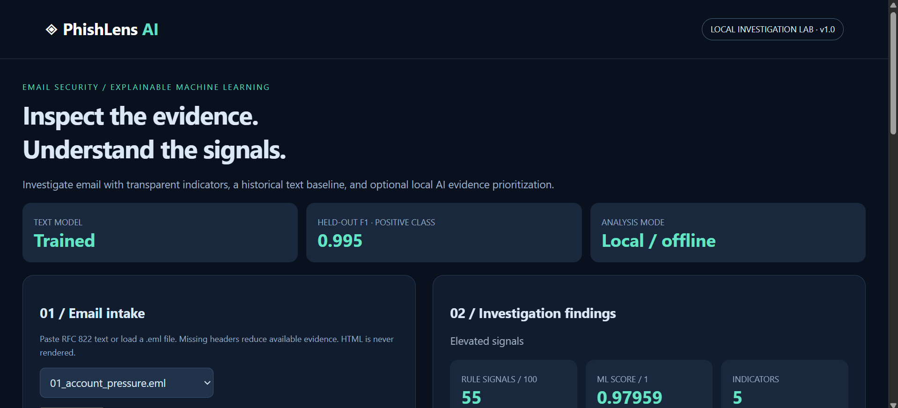
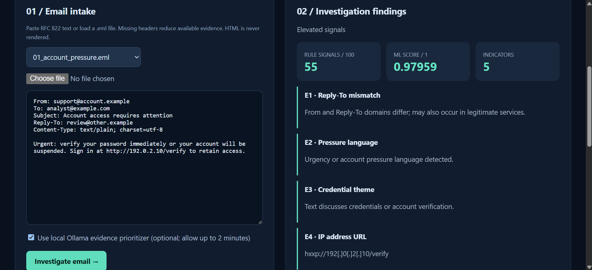

# PhishLens AI

**An explainable email investigation lab built by Fawaz Salman.**

PhishLens combines safe MIME inspection, lexical URL/header indicators, a lightweight text classifier, and optional local LLM evidence prioritization. It supports defensive investigation practice and makes model failures visible rather than hiding them behind a single accuracy number.

## What it does

- Investigates pasted emails or original `.eml` files in a local dashboard.
- Extracts From/Reply-To metadata, claimed authentication results, plain/HTML text, link targets, and attachment metadata without rendering message HTML or executing attachments.
- Flags urgency, credential themes, mismatched reply domains, IP URLs, URL userinfo, punycode, risky attachment extensions and simple prompt-injection patterns.
- Shows separate rule signals and uncalibrated TF-IDF/logistic-regression scores, including positive and negative term contributions.
- Exports JSON evidence and plain-text investigation reports with SHA-256 message hashes.
- Optionally asks a small Ollama model to select evidence IDs. Raw email content does not enter the LLM prompt, and the LLM cannot change scores.
- Trains on real public research data; measures held-out and cross-source performance, plus an explicitly synthetic challenge set.

**Windows users:** use Python 3.12 and PowerShell. No paid services, GPU, Docker or API key are required. Quick start:

```powershell
py -3.12 -m venv .venv
.\.venv\Scripts\python.exe -m pip install -r requirements.txt
.\.venv\Scripts\python.exe -m phishlens train
.\.venv\Scripts\python.exe -m unittest discover -s tests -v
.\.venv\Scripts\python.exe -m phishlens challenge
.\.venv\Scripts\python.exe -m phishlens serve
```

Open http://127.0.0.1:8765. Stop with Ctrl+C. Retraining requires restarting the server. The downloadable bundle includes a trained numeric JSON model; GitHub excludes it and raw corpora so others can reproduce training rather than download private email content or executable model pickles.

## Screenshots





The local PowerShell walkthrough and publishing notes are in `START_HERE.md`; that personal working guide is deliberately kept out of the public repository. The public setup steps are above.

## Measured results and limitations

The release was trained on CEAS_08 plus Nazario, with normalized exact duplicate removal before an 80/20 stratified split. TF-IDF is fitted only on training rows. The external Nigerian_5 benchmark excludes exact overlaps with the entire development corpus. These corpora contain historical spam, fraud and phishing; they do not establish modern production phishing accuracy.

| Evaluation | Samples | Positive precision | Positive recall | Positive F1 |
| --- | ---: | ---: | ---: | ---: |
| Mixed held-out development split | 8,103 | 0.9963 | 0.9931 | 0.9947 |
| External Nigerian_5 after overlap removal | 5,684 | 0.9197 | 0.5225 | 0.6664 |

At the fixed 0.5 threshold, external results contain **1,571 missed positives and 150 false positives**. This is a substantial generalization gap. Exact deduplication does not eliminate near-duplicate templates or campaign leakage. The external source is fraud-focused, so it also differs from credential-phishing messages. Scores are not calibrated inbox probabilities.

The earlier CEAS-only experiment detected just 20% of a separate Nazario phishing set. It is retained in `reports/baseline_ceas_only.json` as a failure analysis, and can be reproduced with `python -m phishlens train --baseline`. Adding Nazario to development changes the experimental population; do not present the subsequent experiment as an independent retest on Nazario.

See [the data card](docs/RESEARCH_AND_DATA.md), [verification record](docs/VERIFICATION.md), and actual JSON reports. The challenge set is deliberately small and must not be used to claim robustness against LLM-generated phishing broadly.

## Design

`email bytes → MIME/text parser → rule evidence + text model → local report`

The optional LLM receives a separate constrained list of detector IDs/categories/weights and returns selected IDs. Human-readable explanations come from the detector. The server binds only to loopback, checks Host, uses a session token for analysis requests, avoids CORS access, and inserts findings as text in the browser.

This is an educational local application, not an internet-facing hardened service. There is no DNS lookup, URL reputation feed, attachment scanner, sandbox, mail gateway integration, or independent SPF/DKIM/DMARC validation. Reported Authentication-Results text can be forged. A low score does not prove an email safe. Public corpora can contain personal details; raw datasets and private investigation reports should not be published.

## Repository map

| Location | Purpose |
| --- | --- |
| `phishlens/engine.py` | MIME parser and deterministic evidence |
| `phishlens/model.py` | Numeric JSON inference and linear term contributions |
| `phishlens/train.py` | Real-data fitting, evaluation, overlap checks and error index |
| `phishlens/data.py` | Checksum-verified downloads and data cleaning |
| `phishlens/llm.py` | Optional local constrained evidence selection |
| `phishlens/web.py`, `index.html` | Loopback server and dashboard |
| `tests/` | Parser, safety-boundary, model and HTTP checks |
| `samples/` | AI-authored inert challenge emails and provenance |
| `reports/` | Benchmark outputs and failure analysis |
| `docs/` | Data, research, verification and operations notes |

## Attribution

Code: MIT. Public datasets: source record declares CC BY 4.0, with separate attribution for derived numeric model weights. See LICENSE and the data card. Dataset: Champa et al., *Phishing Email Curated Datasets*, Zenodo, DOI https://doi.org/10.5281/zenodo.8339691; related ISDFS and ICMI papers (2024). Third-party dependencies and local model downloads retain their licences.
